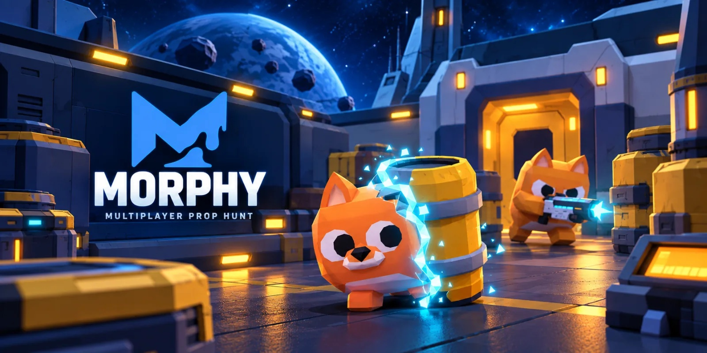

# Morphy



Browser multiplayer prop hunt. Low-poly 3D, LAN-first.

Play it at [morphy.radonforge.com](https://morphy.radonforge.com).

## Requirements

- Node ≥ 24
- pnpm 11 (the pinned version is declared in `package.json`)

## Setup

```bash
pnpm install
```

## Development

```bash
pnpm dev
```

Starts the game server (Colyseus, port `2567`) and the client (Vite, port `5173`) in parallel.
Open the client at the URL printed by Vite (default `http://localhost:5173`).

To start them separately:

```bash
pnpm dev:server
pnpm dev:client
```

## Checks

```bash
pnpm typecheck   # tsc --noEmit across all packages
pnpm check       # Biome lint + format check
pnpm test        # boundary, map, bot, storage and room regression tests
pnpm check:ci    # the non-mutating Biome gate used in CI
```

## LAN play

1. The host runs `pnpm dev`. Vite serves on the local network (`host: true`) and proxies
   `/colyseus` (WebSocket included) to the game server on `:2567`.
2. Teammates open `http://<host-ip>:5173` (e.g. `http://192.168.1.42:5173`); the client reaches
   the server through the proxy, with no extra configuration.
3. To point at a separate/standalone server instead, set `VITE_SERVER_URL`
   (see `packages/client/.env.example`).

## Remote play

```bash
pnpm tunnel
```

Runs ngrok on `5173`, exposing a single tunnel that covers both the client and the WebSocket.
Set `NGROK_DOMAIN` to use a reserved domain.

## Status

Playable: public matchmaking and private party rooms; lobby with map, avatar and weapon pickers,
name and ready state; full round state machine
(`lobby → starting → hiding → hunting → round_end`); server-authoritative roles, HP, shooting
(infection capture), decoys and win conditions; client-side movement + collision; prop disguises;
chat, standings, kill feed and persistent lifetime stats; runtime-synthesized audio.

## Contributing

Bug reports, ideas and pull requests are welcome: start with [CONTRIBUTING.md](CONTRIBUTING.md).
`AGENTS.md` is the architecture guide, for people and coding agents alike. Report security
issues privately, as [SECURITY.md](SECURITY.md) describes.

## License

The code is [MIT](LICENSE). The Morphy name and logo, the official instance's legal pages and the
third-party models and audio are not: [COPYING.md](COPYING.md) lists what is covered by what.
Morphy is made by [Radon Forge](https://radonforge.com).
